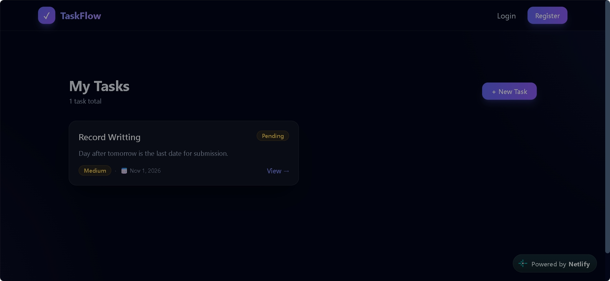
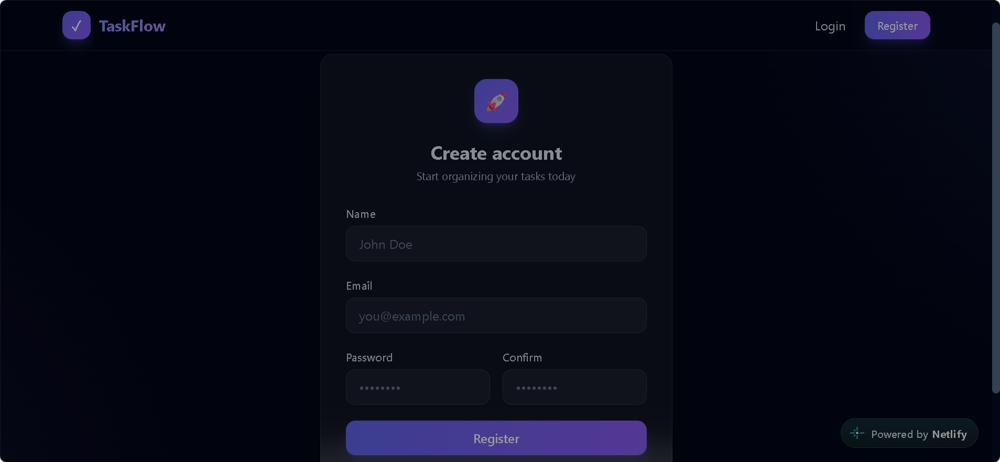

<div align="center">

# 📝 Task Manager

### Plan your work. Manage your tasks. Stay organised.

A full-stack task management application built with the **MongoDB, Express.js, React, and Node.js (MERN) stack**.

<br/>

<a href="https://task-manager-mern23.netlify.app/">
  
</a>
<a href="https://github.com/vankayalavamsi/Task-Manager-MERN">
  
</a>

<br/><br/>


</div>

---

## 📌 About the Project

**Task Manager** is a web application that helps users organise their work by creating and managing personal tasks.

Users can register, log in, and access a dashboard where they can manage their tasks. The application uses a React frontend to provide the user interface and a Node.js/Express backend to handle requests and communicate with MongoDB.

### 🎯 What this project demonstrates

- Building a full-stack application using the MERN stack.
- Creating REST API endpoints with Express.js.
- Connecting a backend application to MongoDB using Mongoose.
- Implementing user authentication with JWT.
- Hashing passwords with bcrypt.
- Connecting a React frontend to a backend API.

---

## 🌐 Live Application

<div align="center">

### Try the application

[**Open Task Manager →**](https://task-manager-mern23.netlify.app/)

</div>

---

## 🖼️ Application Screenshots

The README uses only the three images available in the repository's `screenshots/` folder.

### 1. Dashboard

The dashboard is the main area for a logged-in user to view and manage their tasks.

<p align="center">
  
</p>

### 2. Register

New users can create an account through the registration page.

<p align="center">
  
</p>

### 3. Add Tasks

Users can enter task information and create a new task from this page.

<p align="center">
  
</p>

---

## ✨ Features

| Feature | Explanation |
|---|---|
| 👤 User Registration | Allows new users to create an account. |
| 🔐 User Login | Allows registered users to sign in. |
| 🛡️ Authentication | Uses JWT-based authentication and bcrypt password hashing. |
| 📊 Dashboard | Provides a central place to access task management features. |
| ➕ Create Tasks | Allows users to add tasks with relevant details. |
| 📋 View Tasks | Retrieves tasks for the authenticated user. |
| ✏️ Update Tasks | Allows existing task information to be updated. |
| 🗑️ Delete Tasks | Allows users to remove tasks. |
| 🔒 Protected Routes | Restricts private API operations to authenticated users. |
| 🔔 Notifications | Uses React Toastify to display feedback messages. |

---

## 🔄 How the Application Works

The application follows a straightforward user journey:

1. **Register:** A new user creates an account.
2. **Login:** The user enters their credentials to sign in.
3. **Authenticate:** The backend verifies the credentials and uses JWT for authentication.
4. **Open Dashboard:** The authenticated user accesses the task management area.
5. **Manage Tasks:** The user creates, views, updates, or deletes tasks.
6. **Save Data:** The backend communicates with MongoDB to store and retrieve application data.
7. **Logout:** The user can end their authenticated session.

---

## 🏗️ Application Architecture

The frontend, backend, and database work together to process each task operation.

```text
             ┌──────────────────────┐
             │        USER          │
             └──────────┬───────────┘
                        │
                        ▼
             ┌──────────────────────┐
             │    REACT FRONTEND    │
             │                      │
             │  Pages & Components  │
             │  React Router        │
             │  Axios               │
             └──────────┬───────────┘
                        │
                   API Requests
                        │
                        ▼
             ┌──────────────────────┐
             │   NODE + EXPRESS     │
             │                      │
             │  Routes & Controllers│
             │  Authentication      │
             │  Business Logic      │
             └──────────┬───────────┘
                        │
                     Mongoose
                        │
                        ▼
             ┌──────────────────────┐
             │       MONGODB        │
             │                      │
             │   User & Task Data   │
             └──────────────────────┘
```

### Component Responsibilities

| Component | Responsibility |
|---|---|
| React | Displays the application interface. |
| React Router | Manages navigation between pages. |
| Axios | Sends requests from the frontend to the backend. |
| Node.js | Runs the server-side JavaScript application. |
| Express.js | Handles API routes and HTTP requests. |
| JWT | Supports authenticated access to protected routes. |
| bcrypt | Hashes user passwords. |
| Mongoose | Provides the connection between Express and MongoDB. |
| MongoDB | Stores application data. |

---

## 🧰 Technologies Used

| Technology | Purpose |
|---|---|
| **React** | Frontend user interface |
| **Vite** | Frontend development and build tool |
| **React Router** | Page navigation |
| **Axios** | API communication |
| **Tailwind CSS** | Styling |
| **React Toastify** | Notifications |
| **Node.js** | Backend runtime |
| **Express.js** | Backend API |
| **MongoDB** | Database |
| **Mongoose** | MongoDB object modelling |
| **JWT** | User authentication |
| **bcrypt** | Password hashing |

---

## 📁 Project Structure

```text
Task-Manager-MERN/
│
├── Backend/
│   ├── controllers/       # Request handling and application logic
│   ├── db/                # Database connection
│   ├── middleware/        # Authentication middleware
│   ├── models/            # Database models
│   ├── routes/            # API route definitions
│   ├── utils/             # Reusable utility functions
│   ├── app.js             # Backend entry point
│   └── package.json       # Backend dependencies and scripts
│
├── Frontend/
│   ├── public/            # Public assets
│   ├── src/               # React source code
│   ├── index.html         # HTML entry point
│   └── package.json       # Frontend dependencies and scripts
│
├── screenshots/
│   ├── dashboard.png
│   ├── register.png
│   └── add tasks.png
│
└── README.md
```

---

## ⚙️ Installation and Setup

Follow the steps below to run the application on your local machine.

### Prerequisites

Install these tools before starting:

- [Node.js](https://nodejs.org/)
- npm
- [MongoDB Atlas](https://www.mongodb.com/atlas) or a local MongoDB database
- [Git](https://git-scm.com/)

### Step 1: Clone the repository

Open your terminal and run:

```bash
git clone https://github.com/vankayalavamsi/Task-Manager-MERN.git
```

Move into the project directory:

```bash
cd Task-Manager-MERN
```

### Step 2: Install backend packages

```bash
cd Backend
npm install
```

**What this does:** Installs the packages required by the Node.js and Express backend.

### Step 3: Configure environment variables

Create a file named `.env` inside the `Backend` folder.

Add your MongoDB connection string and backend port:

```env
PORT=8080
MONGO_URI=your_mongodb_connection_string
```

Replace `your_mongodb_connection_string` with your own MongoDB connection string.

> 🔒 **Keep your credentials private.** Never upload your `.env` file or database credentials to GitHub.

### Step 4: Start the backend server

Run this command inside the `Backend` folder:

```bash
npm run dev
```

**What this does:** Starts the backend development server using the project's development script.

### Step 5: Install frontend packages

Open a **new terminal** and navigate to the frontend folder from the project root:

```bash
cd Frontend
npm install
```

**What this does:** Installs React and the other packages required by the frontend.

### Step 6: Start the frontend

```bash
npm run dev
```

**What this does:** Starts the Vite development server. The terminal will display the local URL. Open that URL in your browser.

### Step 7: Create a production build

When you are ready to build the frontend for deployment:

```bash
npm run build
```

**What this does:** Creates an optimised production version of the frontend.

---

## 🔑 Environment Variables

Create `Backend/.env` and configure the following variable:

| Variable | Description | Example |
|---|---|---|
| `PORT` | Port on which the backend runs | `8080` |
| `MONGO_URI` | MongoDB database connection string | Your MongoDB URI |

Make sure the variable names match the names used in the backend configuration.

---

## 🔌 API Overview

The backend provides endpoints for user authentication and task management.

### User Endpoints

| Method | Endpoint | Purpose |
|---|---|---|
| `POST` | `/register` | Register a new user |
| `POST` | `/login` | Log in an existing user |
| `GET` | `/profile` | Retrieve the logged-in user's profile |
| `GET` | `/logout` | Log out the current user |

### Task Endpoints

| Method | Endpoint | Purpose |
|---|---|---|
| `POST` | `/task/create` | Create a task |
| `GET` | `/task/alltasks` | Retrieve the user's tasks |
| `GET` | `/task/task/:id` | Retrieve a task by ID |
| `PUT` | `/task/update/:id` | Update a task |
| `DELETE` | `/task/delete/:id` | Delete a task |

**Note:** The task endpoints require authentication. The exact request body and response format are defined by the backend implementation.

---

## 🚀 Running Both Applications

For local development, keep two terminal windows open.

**Terminal 1: Backend**

```bash
cd Backend
npm install
npm run dev
```

**Terminal 2: Frontend**

```bash
cd Frontend
npm install
npm run dev
```

Once both servers are running, open the frontend URL shown by Vite.

---

## ☁️ Deployment

The frontend is hosted on **Netlify**.

| Item | Address |
|---|---|
| Live Application | [Open Task Manager](https://task-manager-mern23.netlify.app/) |
| GitHub Repository | [View Source Code](https://github.com/vankayalavamsi/Task-Manager-MERN) |

For a separate backend deployment:

1. Deploy the Node.js backend to a compatible hosting service.
2. Add the required environment variables to the hosting provider.
3. Configure the frontend to use the deployed backend API URL.
4. Allow the deployed frontend origin in the backend CORS configuration.
5. Test registration, login, task operations, and logout after deployment.

---

## 🔮 Future Improvements

Some features that could be added in future versions:

- Search tasks by title.
- Filter tasks by status and priority.
- Sort tasks by due date.
- Add task reminders and notifications.
- Add pagination for large task lists.
- Add automated tests.
- Improve accessibility and mobile usability.

---

## 👨‍💻 Author

<div align="center">

### Vankayala Vamsi

[](https://github.com/vankayalavamsi)

</div>

---

<div align="center">

**Thank you for visiting this project!**

If you like this project, please consider giving it a ⭐ on GitHub.

</div>
